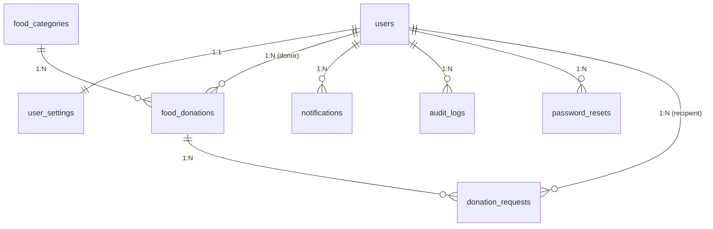

# RePlate — Food Donation & Redistribution Platform

RePlate is a full-stack, role-based web platform built to connect commercial and community food donors with verified food assistance recipients. The system supports real-time surplus food listing, transaction-locked claim requests, administrative moderation, impact analytics (food weight & $\text{CO}_2$ emissions avoided), audit logging, and free multi-channel alerts (**In-App Activity Alerts**, **WhatsApp Quick Handoff**, and **SMTP Email Confirmations**).

---

## System Architectural Overview

RePlate is structured around a decoupled, modular RESTful API architecture running on **PHP 8.2+** and **MySQL / MariaDB 10.4+**. Public entry points, endpoint handler modules, and sensitive configuration files are isolated to enforce clean separation of concerns and the principle of least privilege.

```text
replate/
├── config/
│   ├── db.php                     # Database connection wrapper (PDO, ignored by Git)
│   ├── db.php.example             # Database configuration template for deployment
│   ├── init.php                   # Session & global initialization bootstrapping
│   ├── mail.php                   # Socket-based SMTP mail driver with CID logo embedding (ignored by Git)
│   ├── mail.php.example           # SMTP mail configuration template
│   └── Security.php               # Security headers, input sanitization & rate-limiting engine
├── public/
│   ├── index.php                  # Primary API gateway & fallback routing handler
│   ├── .htaccess                  # Apache/XAMPP rewrite rules for clean URL routing
│   ├── favicon.ico                # Site icon resource
│   ├── activity.html              # User activity & audit log viewer
│   ├── admin-dashboard.html       # Administrative control center
│   ├── dashboard.html             # Role-aware user workspace dashboard
│   ├── donations.html             # Food surplus discovery & listing management
│   ├── index.html                 # Platform entry redirect / landing page
│   ├── login.html                 # User authentication interface
│   ├── register.html              # Donor & Recipient registration page
│   ├── requests.html              # Claim request & WhatsApp handoff management interface
│   ├── settings.html              # Profile, security & free alert channel preferences
│   ├── api/
│   │   ├── activity.php           # User activity metrics & log retrieval
│   │   ├── admin.php              # Admin API router
│   │   ├── categories.php         # Food category taxonomy handler
│   │   ├── donations.php          # Food donation router
│   │   ├── forgot_password.php    # Self-service OTP password recovery router
│   │   ├── notifications.php      # User in-app notification dispatch & management
│   │   ├── reports.php            # CSV impact & audit report generator
│   │   ├── requests.php           # Claim request workflow router
│   │   ├── settings.php           # User profile, password & alert settings API
│   │   ├── users.php              # User authentication & session management router
│   │   ├── admin_handlers/
│   │   │   ├── add_category.php
│   │   │   ├── analytics.php
│   │   │   ├── audit_logs.php
│   │   │   ├── categories.php
│   │   │   ├── delete_category.php
│   │   │   ├── donation_requests.php
│   │   │   ├── listings.php
│   │   │   ├── remove_listing.php
│   │   │   ├── reports.php
│   │   │   ├── send_notification.php
│   │   │   ├── update_user_role.php
│   │   │   ├── update_user_status.php
│   │   │   ├── users.php
│   │   │   └── verify_account.php
│   │   ├── donation_handlers/
│   │   │   ├── delete_donation.php
│   │   │   ├── get_available_listings.php
│   │   │   ├── get_metrics.php
│   │   │   ├── get_my_listings.php
│   │   │   └── post_donation.php
│   │   ├── request_handlers/
│   │   │   ├── cancel_request.php
│   │   │   ├── create_request.php
│   │   │   ├── get_incoming.php
│   │   │   ├── get_my_requests.php
│   │   │   └── manage_request.php
│   │   └── user_handlers/
│   │       ├── get_current_user.php
│   │       ├── login.php
│   │       ├── logout.php
│   │       ├── register.php
│   │       ├── request_password_reset.php
│   │       └── reset_password.php
│   ├── css/
│   │   ├── activity.css
│   │   ├── admin-dashboard.css
│   │   ├── auth.css
│   │   ├── dashboard.css
│   │   ├── donations.css
│   │   ├── main.css
│   │   ├── modals.css
│   │   ├── requests.css
│   │   └── settings.css
│   ├── images/
│   │   └── logo.png               # Platform brand logo (used in UI & CID email templates)
│   └── js/
│       ├── activity.js
│       ├── admin.js
│       ├── auth.js
│       ├── dashboard.js
│       ├── donations.js
│       ├── requests.js
│       ├── settings.js
│       ├── ui.js
│       ├── admin_modules/
│       │   ├── admin_categories.js
│       │   ├── admin_helpers.js
│       │   ├── admin_listings.js
│       │   ├── admin_reports_audit.js
│       │   └── admin_users.js
│       ├── auth_modules/
│       │   ├── auth_engine.js
│       │   ├── auth_forgot.js
│       │   ├── auth_forms.js
│       │   └── auth_logout.js
│       ├── dashboard_modules/
│       │   ├── dashboard_donations.js
│       │   ├── dashboard_metrics.js
│       │   ├── dashboard_notifications.js
│       │   ├── dashboard_post_form.js
│       │   └── dashboard_utils.js
│       └── requests_modules/
│           ├── requests_actions.js
│           ├── requests_helpers.js
│           ├── requests_incoming.js
│           └── requests_my.js
├── sql/
│   └── schema.sql                 # Primary DDL database creation script
├── .gitignore                     # Git exclusion rules
├── Dockerfile                     # Apache/PHP 8.2 container definition
├── README.md                      # Project documentation
├── replate_dump.sql               # Seed database dump
└── router.php                     # Local PHP built-in server clean-URL router


## Entity-Relationship & Database Schema (ERD)

The MySQL database schema (`replate`) consists of eight relational tables with foreign key constraints, indexes, and row-level transaction locks (`SELECT ... FOR UPDATE`).




+-------------------+         +-------------------+         +-------------------+
|       users       |         |  food_donations   |         | donation_requests |
+-------------------+         +-------------------+         +-------------------+
| PK user_id        |<--------| PK donation_id    |<--------| PK request_id     |
|    name           | (1:N)   | FK donor_id       | (1:N)   | FK donation_id    |
|    org_name       |         | FK category_id    |         | FK recipient_id   |
|    email          |         |    food_name      |         |    quantity_req   |
|    normalized_em  |         |    quantity       |         |    status         |
|    password_hash  |         |    pickup_location|         |    created_at     |
|    role           |         |    expiry_date    |         +-------------------+
|    status         |         |    status         |
|    is_verified    |         |    created_at     |         +-------------------+
+-------------------+         +-------------------+         |  food_categories  |
  |         |                                               +-------------------+
  | (1:1)   | (1:N)                                         | PK category_id    |
  v         +-----------------------+                       |    name           |
+-------------------+               v                       |    description    |
|   user_settings   |         +-------------------+         +-------------------+
+-------------------+         |   notifications   |
| PK user_id        |         +-------------------+         +-------------------+
|    phone_number   |         | PK id             |         |    audit_logs     |
|    pickup_instr   |         | FK user_id        |         +-------------------+
|    notify_inapp   |         |    title          |         | PK log_id         |
|    notify_whatsapp|         |    message        |         | FK user_id        |
|    notify_email   |         |    type           |         |    event_type     |
|    discretion_mode|         |    is_read        |         |    action_details |
+-------------------+         +-------------------+         |    ip_address     |
                                                            +-------------------+


### Table Definitions

1. `users`
   * `user_id` (INT, Primary Key, Auto Increment)
   * `name` (VARCHAR 100, NOT NULL)
   * `org_name` (VARCHAR 255, NULL)
   * `email` (VARCHAR 255, UNIQUE, NOT NULL)
   * `normalized_email` (VARCHAR 150, UNIQUE, NOT NULL)
   * `password_hash` (VARCHAR 255, NOT NULL)
   * `role` (ENUM: `'recipient'`, `'donor'`, `'admin'`, DEFAULT `'recipient'`)
   * `status` (VARCHAR 50, DEFAULT `'active'`)
   * `is_verified` (TINYINT 1, DEFAULT `0`)
   * `created_at` (TIMESTAMP, DEFAULT `CURRENT_TIMESTAMP`)

2. `user_settings`
   * `user_id` (INT, Primary Key, Foreign Key → `users.user_id` ON DELETE CASCADE)
   * `phone_number` (VARCHAR 30, NULL)
   * `pickup_instructions` (TEXT, NULL)
   * `notify_inapp` (TINYINT 1, DEFAULT `1`)
   * `notify_whatsapp` (TINYINT 1, DEFAULT `1`)
   * `notify_email` (TINYINT 1, DEFAULT `1`)
   * `discretion_mode` (TINYINT 1, DEFAULT `0`)
   * `updated_at` (TIMESTAMP, DEFAULT `CURRENT_TIMESTAMP ON UPDATE CURRENT_TIMESTAMP`)

3. `food_categories`
   * `category_id` (INT, Primary Key, Auto Increment)
   * `name` (VARCHAR 100, UNIQUE, NOT NULL)
   * `description` (TEXT, NULL)

4. `food_donations`
   * `donation_id` (INT, Primary Key, Auto Increment)
   * `donor_id` (INT, Foreign Key → `users.user_id` ON DELETE CASCADE)
   * `category_id` (INT, Foreign Key → `food_categories.category_id` ON DELETE SET NULL)
   * `food_name` (VARCHAR 255, NOT NULL)
   * `quantity` (VARCHAR 100, NOT NULL)
   * `unit` (VARCHAR 50, NULL)
   * `pickup_location` (VARCHAR 255, NOT NULL)
   * `expiry_date` (DATETIME, NULL)
   * `status` (ENUM: `'Available'`, `'Reserved'`, `'Collected'`, `'Cancelled'`, DEFAULT `'Available'`)
   * `created_at` (TIMESTAMP, DEFAULT `CURRENT_TIMESTAMP`)

5. `donation_requests`
   * `request_id` (INT, Primary Key, Auto Increment)
   * `donation_id` (INT, Foreign Key → `food_donations.donation_id` ON DELETE CASCADE)
   * `recipient_id` (INT, Foreign Key → `users.user_id` ON DELETE CASCADE)
   * `quantity_requested` (VARCHAR 100, NOT NULL)
   * `status` (ENUM: `'Pending'`, `'Approved'`, `'Rejected'`, `'Cancelled'`, DEFAULT `'Pending'`)
   * `created_at` (TIMESTAMP, DEFAULT `CURRENT_TIMESTAMP`)

6. `notifications`
   * `id` (INT, Primary Key, Auto Increment)
   * `user_id` (INT, Foreign Key → `users.user_id` ON DELETE CASCADE)
   * `title` (VARCHAR 255, NOT NULL)
   * `message` (TEXT, NOT NULL)
   * `type` (VARCHAR 50, DEFAULT `'info'`)
   * `is_read` (TINYINT 1, DEFAULT `0`)
   * `created_at` (TIMESTAMP, DEFAULT `CURRENT_TIMESTAMP`)

7. `audit_logs`
   * `log_id` (INT, Primary Key, Auto Increment)
   * `user_id` (INT, Foreign Key → `users.user_id` ON DELETE SET NULL)
   * `event_type` (VARCHAR 100, NOT NULL)
   * `action_details` (TEXT, NOT NULL)
   * `log_type` (VARCHAR 20, DEFAULT `'info'`)
   * `ip_address` (VARCHAR 45, NOT NULL)
   * `created_at` (TIMESTAMP, DEFAULT `CURRENT_TIMESTAMP`)

8. `password_resets`
   * `user_id` (INT, Primary Key, Foreign Key → `users.user_id` ON DELETE CASCADE)
   * `email` (VARCHAR 255, NOT NULL)
   * `token_hash` (VARCHAR 255, NOT NULL)
   * `expires_at` (DATETIME, NOT NULL)

## Detailed API Specification

All API endpoints return standardized JSON payloads:

* **Success:** `{"success": true, "message": "...", "data": {...}}`
* **Failure:** `{"success": false, "error": "ERR_CODE: Descriptive error message"}`


### Authentication & Password Recovery (`/api/users.php` & `/api/forgot_password.php`)

| Method | Endpoint / Action | Description | Input Payload |
| :--- | :--- | :--- | :--- |
| `POST` | `/api/users.php?action=register` | Registers a new donor or recipient account | `email`, `password`, `name`, `role`, `org_name` |
| `POST` | `/api/users.php?action=login` | Authenticates existing user credentials & creates session | `email`, `password` |
| `POST` | `/api/users.php?action=logout` | Destroys active user session | None |
| `GET` | `/api/users.php?action=me` | Fetches active authenticated user profile | None |
| `POST` | `/api/users.php?action=request_reset` | Generates 6-digit OTP and sends branded email | `email` |
| `POST` | `/api/users.php?action=reset_password` | Verifies OTP and updates password hash | `email`, `code`, `new_password` |

### Food Donation Lifecycle (`/api/donations.php`)

| Method | Action Param | Description | Access Control |
| :--- | :--- | :--- | :--- |
| `GET` | `action=list` (default) | Lists available surplus food donations | Public / Recipient / Admin |
| `GET` | `action=my_listings` | Lists donations posted by logged-in donor | Donor |
| `GET` | `action=metrics` | Returns role-specific metrics (posts/claims, active requests, CO₂ saved) | Authenticated User |
| `POST` | N/A | Creates a new food surplus listing | Donor |
| `DELETE` | N/A | Deletes a donation listing (`donation_id`) | Listing Owner / Admin |

### Request, Claim & Multi-Channel Alert Engine (`/api/requests.php`)

| Method | Action Param | Description | Alert & Transaction Logic |
| :--- | :--- | :--- | :--- |
| `GET` | `action=my_requests` | Retrieves claims submitted by active recipient | Respects donor `discretion_mode`; attaches `whatsapp_url` when approved |
| `GET` | `action=incoming` | Retrieves incoming claims for donor's listings | Joins recipient details; attaches `whatsapp_url` when approved |
| `POST` | `action=create` | Submits a new claim request for a donation | `SELECT ... FOR UPDATE` lock; triggers donor In-App & Email alerts |
| `POST` | `action=approve` | Approves claim, marks listing `'Collected'`, rejects competing pending claims | Triggers recipient In-App & Email alerts + generates `wa.me` chat link |
| `POST` | `action=reject` | Rejects specific request, keeps listing `'Available'` | Updates status to `'Rejected'`; notifies recipient |
| `POST` | `action=cancel` | Recipient cancels their own pending claim request | Updates status to `'Cancelled'` |

### Settings, Notifications & Admin Control (`/api/settings.php`, `/api/notifications.php`, `/api/admin.php`)

| Method | Endpoint | Description |
| :--- | :--- | :--- |
| `GET` / `POST` | `/api/settings.php` | Reads and updates profile details, password, and `notify_inapp`, `notify_whatsapp`, `notify_email` toggles |
| `GET` / `POST` | `/api/notifications.php` | Retrieves in-app notifications (`limit=50`), marks single/all as read, or clears history |
| `GET` / `POST` | `/api/admin.php` | Manages analytics, user verification/roles/status, categories, listings, requests, broadcasts, CSV reports, and audit logs |

## Security Implementation Specifications

1. **SQL Injection Protection:** All queries execute via PDO prepared statements with bound parameters (`PDO::ATTR_EMULATE_PREPARES => false`).
2. **Cross-Site Scripting (XSS) Prevention:** User-generated content is escaped server-side with `htmlspecialchars(..., ENT_QUOTES, 'UTF-8')` and client-side via DOM text escaping utilities.
3. **Session-Backed Rate Limiting (`config/Security.php`):** Protects authentication, password reset requests, settings updates, and claim creation against brute-force or spam floods.
4. **HTTP Security Headers:** Enforces `X-Frame-Options: DENY`, `X-Content-Type-Options: nosniff`, `Referrer-Policy: strict-origin-when-cross-origin`, and Content Security Policy rules.
5. **Credential & Secret Isolation:** Passwords are hashed with `PASSWORD_BCRYPT`. Active secrets (`config/db.php` and `config/mail.php`) are excluded from version control via `.gitignore`.

## Environment Setup & Installation Guide

### Prerequisites

* PHP 8.2 or higher (with `pdo_mysql` and `openssl` enabled)
* MySQL 10.4+ or MariaDB
* Apache with `mod_rewrite` enabled (XAMPP / LAMP) or PHP built-in development server
* Docker Desktop (optional)

### Step-by-Step Local Deployment

1. **Clone the Repository:**

   ```bash
   git clone https://github.com/mahneeofficial/replate.git
   cd replate
   ```

2. **Database Initialization:**
   * Create a MySQL database named `replate`.
   * Import the schema and seed data:

   ```bash
   mysql -u root -p replate < sql/schema.sql
   mysql -u root -p replate < replate_dump.sql
   ```

3. **Configure Local Environment Files:**
   * Copy the example configuration templates:

   ```bash
   cp config/db.php.example config/db.php
   cp config/mail.php.example config/mail.php
   ```

   * Update `config/db.php` with your MySQL credentials (`DB_HOST`, `DB_NAME`, `DB_USER`, `DB_PASS`).
   * Update `config/mail.php` with your SMTP server details and 16-character Gmail App Password (`MAIL_USER`, `MAIL_PASS`).

4. **Start the Application Server:**
   * **Option A — PHP Built-in Server (WSL / Linux / macOS / Windows CLI):**

   ```bash
   sudo service mysql start
   php -S localhost:8000 router.php
   ```

   Open `http://localhost:8000` in your browser.

   * **Option B — XAMPP Apache (No Terminal Required):**
     * Start Apache and MySQL in the XAMPP Control Panel.
     * Point Apache's `DocumentRoot` to `.../replate/public` (with `AllowOverride All` enabled so `public/.htaccess` handles clean URLs) and open `http://localhost`.

### Containerized Deployment (Docker)

1. **Build Container Image:**

   ```bash
   docker build -t replate-app .
   ```

2. **Run Container:**

   ```bash
   docker run -d -p 8080:80 \
     -e DB_HOST=host.docker.internal \
     -e DB_NAME=replate \
     -e DB_USER=root \
     -e DB_PASS=YOUR_LOCAL_MYSQL_PASSWORD \
     --name replate_container replate-app
   ```

3. **Access Platform:** Navigate to `http://localhost:8080`.


## Error & System Logging Reference

| Error Code | Category | Cause / Resolution |
| :--- | :--- | :--- |
| `ERR_SYS_00` | Configuration | Database configuration file missing or PDO connection refused. Verify MySQL is running and `config/db.php` is configured. |
| `ERR_SYS_01` | System | Internal server exception thrown. Check PHP or Apache error logs. |
| `ERR_AUTH_01` | Authentication | Action attempted without an active session. Prompt user login. |
| `ERR_AUTH_02` | Authorization | User lacks adequate role permissions to modify target resource. |
| `ERR_REQ_01` | Claim Workflow | Listing is no longer `'Available'`. |
| `ERR_REQ_03` | Claim Workflow | Donor attempted to request their own listed donation. |
| `ERR_REQ_04` | Claim Workflow | Recipient already has an active pending claim for the item. |
| `ERR_VAL_01` | Validation | Missing required payload parameters or input validation check failed. |

## Maintenance & Testing Commands

```bash
# Check PHP syntax across all API endpoint scripts
find public/api/ -name "*.php" -exec php -l {} \;

# Tail Apache error logs (Linux/WSL)
tail -n 100 /var/log/apache2/error.log
```

## License & Project Attribution

Designed and built for the RePlate Food Redistribution Project. Distributed under the MIT License.

### Author

* **Brian Kimani** https://github.com/mahneeofficial
